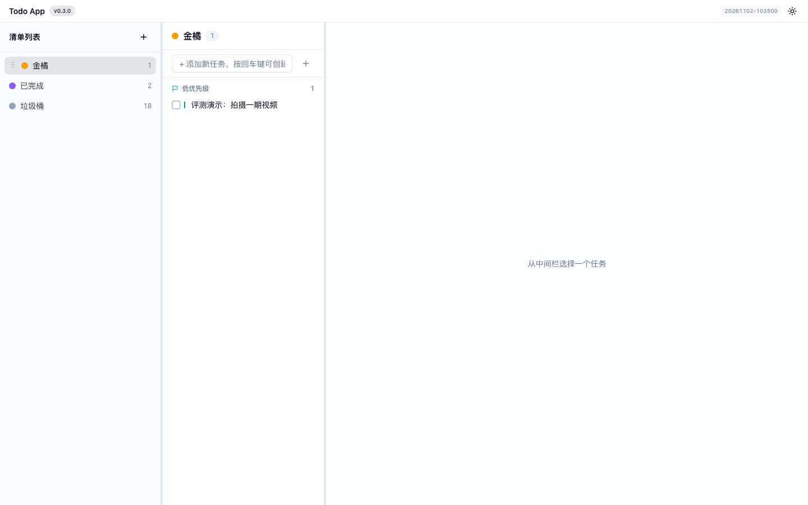
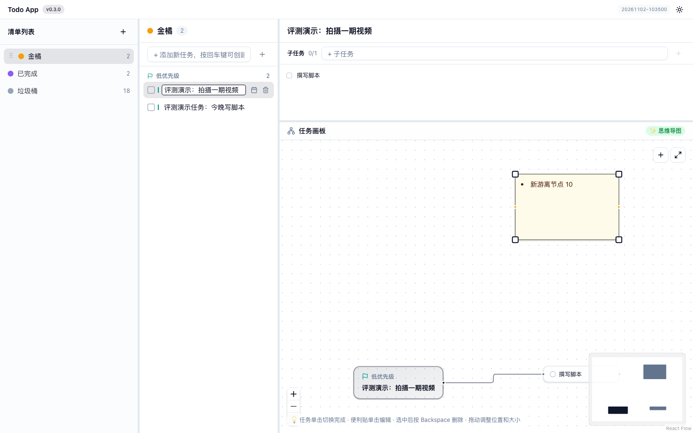
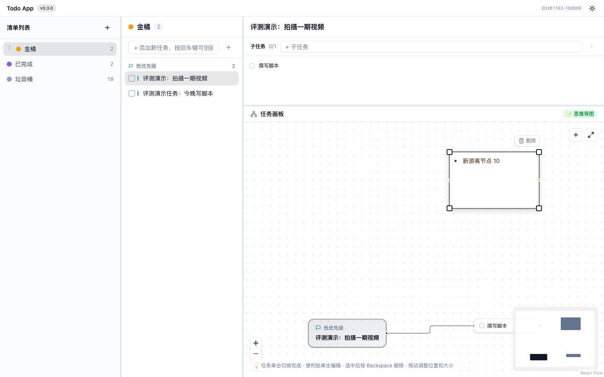
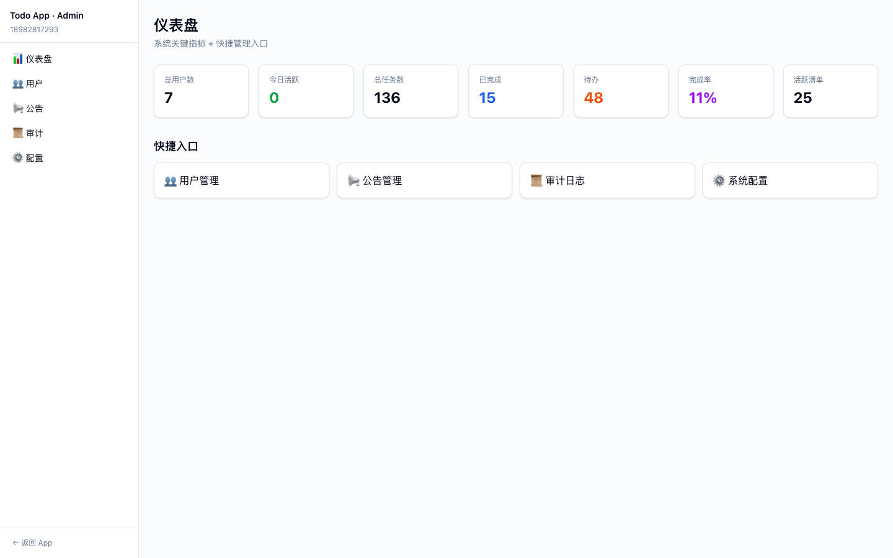
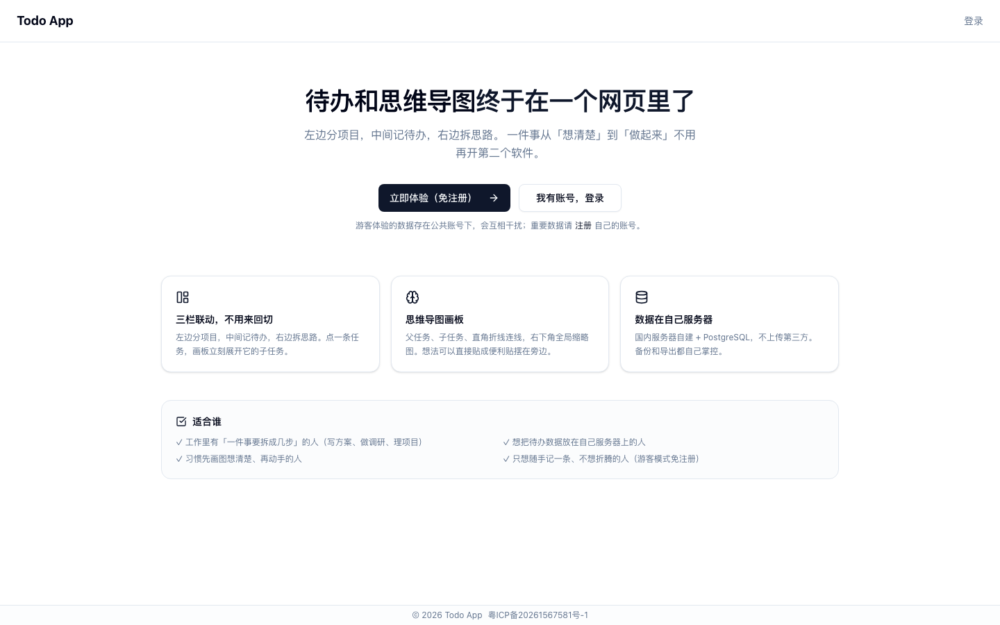

# Todo App · 待办 + 思维导图

> **左边分项目，中间记待办，右边拆思路。**
> 一个人的待办系统：清单 / 任务 / 子任务 / 思维导图画板 / 便利贴，数据存在自己的服务器上。



<details>
<summary>更多截图（画板 / 便利贴 / 后台 / 落地页 / 移动端）</summary>

**思维导图画板** —— 父任务、子任务直角折线、右下角全局缩略图


**便利贴** —— 选中后上方浮出删除按钮


**管理后台** —— 完成率、活跃清单、操作留痕


**公开落地页** —— 未登录也能看到产品内容（备案要求）


**移动端** —— 底部三个 tab


</details>

---

## 为什么做这个

用了七八个待办工具，都卡在同一个地方：**待办和思维导图是两张皮**。

- 滴答清单 / Microsoft To Do：记条目很快，但「一件事拆成三步」只能塞进描述，写完就没人再看
- Notion：什么都能写，但打开要 3 秒，等页面渲染完我才想起要记什么
- 幕布 / XMind：拆解很漂亮，但**拆完的结论不会自动变成一条待办**

于是在 2026 年 10 月，我用 Next.js 写了这个东西：一件事从「想清楚」到「做起来」不用再开第二个软件。

---

## 功能

| | |
|---|---|
| **三栏联动** | 清单列表 / 任务列表 / 思维导图画板，点一条任务，画板立刻展开它的子任务 |
| **思维导图画板** | 父任务、子任务、直角折线连线，右下角全局缩略图（MiniMap） |
| **便利贴** | 文字或图片，贴在画板旁边随手记想法；可拖动、**实时缩放**、可删除 |
| **优先级与截止日期** | 高/中/低三组自动分组，hover 出日历设截止日，逾期标红 |
| **子任务双向同步** | 列表里加的子任务，画板上同步长出来（反之亦然） |
| **回收站** | 删掉的任务进回收站，可恢复 / 永久删除 / 一键清空 |
| **游客模式** | 不用注册，点一下直接体验 |
| **移动端** | 手机上底部三个 tab（清单 / 任务 / 画板） |
| **管理后台** | 用户管理、公告、审计日志、系统配置（自己用也做了一套后台） |
| **找回码机制** | 密码找回靠高熵「找回码」而不是「记得密码片段」，库里只存哈希 |

---

## 技术栈

| 层 | 技术 | 版本 |
|---|---|---|
| 前端框架 | Next.js（App Router）+ React + TypeScript | 16.3.5 / 19.2.8 / 5.x |
| 画板 | React Flow | 12.11.x |
| 状态管理 | Zustand | 5.x |
| 样式 | Tailwind CSS v4（oklch 主题） | 4.x |
| 认证 | NextAuth v5（Credentials + JWT） | 5.0.0-beta.32 |
| 数据库 | PostgreSQL + Prisma | 16 / 5.x |
| 部署 | Docker Compose + Caddy（自动 HTTPS） | - |

---

## 快速开始（本地开发）

```bash
# 需要 Node >= 20、pnpm >= 8
git clone <this-repo> todo-app
cd todo-app
pnpm install

# 准备数据库
cp deploy/.env.example .env      # 改 DB_PASSWORD / NEXTAUTH_SECRET
docker compose -f deploy/docker-compose.prod.yml up -d db

# 初始化表
pnpm --filter @todo/db db:deploy

# 起开发服务器
pnpm --filter web dev
```

打开 http://localhost:3000

---

## Docker 部署（生产）

```bash
# 1. 配置
cp deploy/.env.example deploy/.env
#    至少改 DB_PASSWORD / NEXTAUTH_SECRET / DOMAIN
chmod 600 deploy/.env

# 2. 构建 + 启动（DOMAIN 指向你的域名，Caddy 自动申请证书）
bash scripts/rebuild-and-deploy.sh

# 3. 看版本
curl https://你的域名/version.json
```

| 脚本 | 作用 |
|---|---|
| `scripts/rebuild-and-deploy.sh` | 构建镜像 → 打时间戳 tag → 迁移 → 重建容器 → 健康检查（失败 exit 1） |
| `scripts/backup.sh <project> [保留天数]` | pg_dump + 上传目录打包 + 清理过期备份 |
| `scripts/cleanup-old-images.sh` | 清理历次部署留下的历史镜像 |
| `scripts/cleanup-test-data.sh` | 安全清理测试数据（先预览，默认不删） |
| `scripts/healthcheck-watchdog.sh` | 每分钟健康检查，挂了自动拉起 |

> ⚠️ **两个 compose 铁律**（我在这上面踩过坑，写在这里省你踩）：
> 1. 一定要带 `-p <project>`：compose 用 project 名给卷加前缀，撞名会让两个项目共用一个卷
> 2. 一定要带 `--env-file deploy/.env`：compose 只在**当前目录**找 `.env`，不带它所有变量都是空
>
> 还有：不要用裸 `docker compose up -d`（会试图重建不属于本 compose 的容器 → 中断 → 站点 502），用 `--no-deps <service>`。

---

## 环境变量

全部在 `deploy/.env`（**只放服务端，绝不进仓库**）。复制 `deploy/.env.example` 后改：

| 变量 | 必填 | 说明 |
|---|---|---|
| `DB_USER` / `DB_PASSWORD` / `DB_NAME` | ✅ | PostgreSQL 连接信息 |
| `NEXTAUTH_SECRET` | ✅ | `openssl rand -base64 32` 生成 |
| `DOMAIN` | ✅ | 正式域名（Caddy 据此申请证书并反代） |
| `GUEST_PHONE` / `GUEST_PASSWORD` | ❌ | 不配则登录页不显示「游客体验」；**务必与手机号不同** |
| `NEXT_PUBLIC_ICP_NUMBER` | ❌ | 工信部备案号，渲染在页脚；**改完要重新 build**（构建期内联进前端 bundle） |

> `environment` 在 compose 里是**白名单**：`.env` 里加了变量但 compose 没列 → 容器里根本没有那个变量。

---

## 数据与同步

- 客户端本地 store（localStorage）立即响应，**后台异步全量推送**到服务端
- 服务端 `POST /api/sync/bulk` 做全量 upsert，并带**乐观锁**：
  客户端每条数据都有 `updatedAt` 版本号，服务端发现你推上来的比库里旧 → **跳过这一行不覆盖**
  （否则多端同时开会互相覆盖：我删的清单会被旧标签页的旧数据推回来「复活」）
- 删除类变更**立即推送**，不等 debounce；页面卸载/切后台用 `sendBeacon` 兜底
- 失效外键会被服务端**重映射或丢弃**，响应里带 `conflicts` / `dropped` 计数
  （一条脏数据不会让整批同步回滚）

---

## 已知限制

诚实列一下，这也是我下一步要做的：

- **没有全局搜索** —— 任务一多只能靠翻清单
- **没有提醒推送** —— 截止日期就是个标签，到点不响
- **没有多人协作** —— 没有共享清单、指派、评论
- **手机上画板基本没法编辑** —— 手指头拖不动那些小方块
- **没有导出** —— 数据备份得自己写脚本
- **管理后台入口没有 UI 链接**，得手动敲 `/admin`

---

## 目录结构

```
apps/web/            Next.js 应用（三栏布局、画板、面板、认证路由）
  src/components/
    canvas/          思维导图画板、节点组件（便利贴）
    layout/          三栏布局、页脚备案号
    panels/          清单面板 / 任务面板 / 画板面板
  src/app/api/       同步、认证、上传、管理后台接口
packages/db/         Prisma schema 与迁移
deploy/              compose / Dockerfile / Caddyfile / .env.example
scripts/             部署、备份、清理脚本
docs/                截图与内容稿
AGENTS.md            工程约定与踩坑记录（这个仓库的「说明书」）
```

---

## 工程约定

这个仓库用 **AGENTS.md** 记录工程约定与踩过的坑（不是流水账，是「下次别再踩」的清单）：
组件化分层、状态同步一致性、验证闭环、数据安全红线……
写代码前先读 `AGENTS.md`。

---

## 脱敏说明

发布前做了这些处理（如果你 fork 自己用，注意对应位置）：

- 仓库内**不含任何密钥**：`.env` 已在 `.gitignore`，只有 `.env.example` 模板
- 真实**手机号、密码、user id** 已从 e2e 用例、清理脚本、文档中移除，改为环境变量注入
- 数据库里的**明文密码列**已在迁移中彻底删除，找回密码改用「找回码」（bcrypt 哈希）
- 文档与注释里的服务器 IP 泛化成 `<server-ip>`；部署配置里保留的是**功能性引用**
- **备案号不硬编码**：`NEXT_PUBLIC_ICP_NUMBER` 走环境变量注入（构建期 build-arg + 运行期 compose 双通道），
  模板默认不冒名任何主体；境内正式对外提供服务前请自行填
- `public/version.json` 是构建期产物，已加入 `.gitignore`

---

## License

MIT
